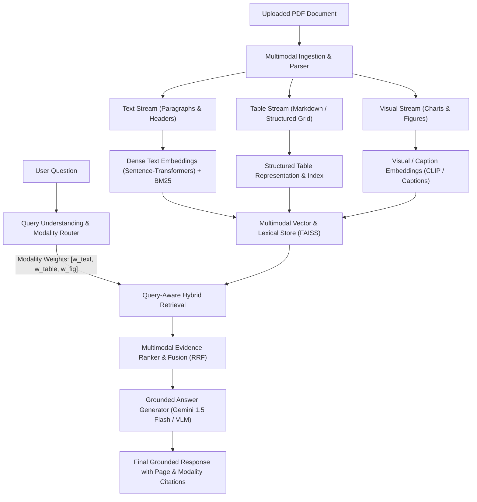

# Query-Aware Multimodal Evidence Fusion for Grounded Document Question Answering

> **Final-Year Engineering Project**  
> An intelligent, grounded document question-answering architecture that extracts, indexes, routes, and fuses multimodal evidence (text, tables, and figures/charts) with verifiable page citations.

---

## 📌 Project Overview & Research Motivation

Standard Document Question-Answering (RAG) systems suffer from two critical flaws when applied to real-world documents (e.g., scientific papers, annual financial reports, technical specifications):
1. **Modality Neglect:** They treat documents solely as plain text, either discarding or misinterpreting structured tables and visual charts.
2. **Modality Blindness:** When answering questions, standard retrieval models execute flat searches across all chunks without considering whether the specific question fundamentally demands quantitative tabular data, conceptual text definitions, or visual trend comparisons.

### 🎯 Research Innovation: Query-Aware Modality Selection & Evidence Fusion
This project investigates **Query-Aware Multimodal Evidence Fusion**:
- **Query Understanding & Routing:** Analyzing user query intent to dynamically predict modality affinities ($w_{\text{text}}, w_{\text{table}}, w_{\text{figure}} \in [0, 1]$).
- **Multimodal Evidence Extraction & Indexing:** Parsing multi-page PDFs into isolated, attributed evidence streams (text paragraphs, structured tables, and visual charts/figures).
- **Weighted Reciprocal Rank Fusion (RRF):** Fusing dense semantic and sparse lexical retrieval across modalities guided by the query's modality distribution.
- **Grounded Answer Generation with Page-Level Citations:** Formulating generation constraints that require all factual claims to cite exact document coordinates (e.g., `[Page 7, Table 3]`, `[Page 12, Figure 4]`).

---

## 🏛️ System Architecture



---

## 🛠️ Technology Stack & Practical Justification

| Layer | Recommended Technology | Practical Justification & Cost / Hardware Profile |
| :--- | :--- | :--- |
| **User Interface** | **Streamlit** (v1.58+) | Rapid interactive prototyping, rich layout controls, native support for sidebars, tabs, and real-time visualization. |
| **PDF Extraction** | **PyPDF2 / pdfplumber** | Lightweight, pure-Python compatible, extracts text layout and structured table bounding boxes without heavy external binaries. |
| **Text Embeddings** | **`all-MiniLM-L6-v2`** (`sentence-transformers`) | Ultra-fast (384-dim), runs efficiently on CPU, zero API cost, high retrieval fidelity for technical and domain-specific text. |
| **Image / Chart Repr.** | **OpenAI CLIP / Captioning** | Bridges image and text modalities; lightweight vision-language representation for diagrams and charts. |
| **Vector Indexing** | **FAISS-CPU** + **Rank-BM25** | High-performance CPU vector search with zero infrastructure overhead combined with BM25 lexical precision for acronyms/entities. |
| **Answer Generation** | **Google Gemini 1.5 Flash** | Cost-effective (free tier available via AI Studio), generous context window, multimodal vision support, fast inference. |
| **Fallback / Local Mode**| **Mock / Heuristic Provider** | Allows offline execution and testing without needing paid API keys or external network connections. |

---

## 📁 Project Directory Structure

```text
Query aware multimodal qa/
├── config/
│   └── config.yaml             # System parameters, models, thresholds, and routing settings
├── data/
│   ├── extracted/              # Cache for extracted text, tables, and cropped figures (.gitkeep)
│   ├── indices/                # Local FAISS index and BM25 persistent stores (.gitkeep)
│   └── uploads/                # Staged uploaded PDF documents (.gitkeep)
├── src/
│   ├── __init__.py
│   ├── config.py               # Settings loader, environment variable resolution, directory safety
│   ├── ingestion/              # [Phase 2] PDF parsing, table extraction, figure isolation
│   ├── indexing/               # [Phase 3] Unified EvidenceChunk schema, vector indexing, BM25
│   ├── query_understanding/    # [Phase 4] Query intent analysis & modality routing
│   ├── retrieval/              # [Phase 4] Modality-guided hybrid search
│   ├── fusion/                 # [Phase 4] Modality-weighted Reciprocal Rank Fusion
│   ├── generation/             # [Phase 5] Grounded prompting & citation verification
│   ├── evaluation/             # [Phase 6] Benchmark suite (Text-only vs. Multimodal baselines)
│   └── ui/                     # UI components and visualization helpers
├── .env.example                # Environment variables template
├── .gitignore                  # Git ignore rules (secrets, caches, data artifacts)
├── app.py                      # Main Streamlit application entry point (Phase 1 Foundation)
├── requirements.txt            # Dependency specification
└── README.md                   # Project documentation
```

---

## 🚀 Installation & Quickstart

### 1. Prerequisites
- Python 3.10+ (tested and verified on Python 3.14.6)
- Windows PowerShell / Linux / macOS terminal

### 2. Configure Environment
Copy the `.env.example` template to `.env`:
```powershell
cp .env.example .env
```
*(Optional for Phase 1)*: If you have a Google AI Studio API key, paste it into `.env`:
```text
GEMINI_API_KEY=your_gemini_api_key_here
```
> Note: If no API key is provided, the system defaults to safe local/mock mode.

### 3. Install Dependencies
```powershell
pip install -r requirements.txt
```

### 4. Run the Application
Launch the Streamlit web dashboard:
```powershell
python -m streamlit run app.py
```
Open your browser and navigate to: **`http://localhost:8501`**

---

## 🚦 Phase Implementation Status

- [x] **Phase 1: Foundation & Modular Architecture (Completed)**
  - Workspace inspection & dev environment profiling.
  - End-to-end multimodal architecture design.
  - Technology stack definition with cost and hardware analysis.
  - Modular directory layout and configuration management (`config.yaml` + `src/config.py`).
  - Streamlit foundation app verified and running at `http://localhost:8501`.
- [x] **Phase 2: PDF Upload & Text Extraction (Completed)**
  - PDF ingestion and validation pipeline (`src/ingestion/pdf_loader.py`).
  - Collision-free file storage under `data/uploads/` with SHA-256 deduplication.
  - Page-level digital text extraction preserving 1-based page citations (`src/ingestion/text_extractor.py`).
  - Unified evidence representation schema (`EvidenceChunk`, `ExtractedDocument`, `PageText` in `src/indexing/schema.py`).
  - Sentence-aware overlapping chunking with unique chunk IDs.
  - Interactive Streamlit dashboard update with metric cards, chunk filters, raw page inspector, and JSON export.
  - Comprehensive unit test suite (`tests/test_pdf_ingestion.py`) passing 10/10 tests.
- [x] **Phase 3: Table, Chart, and Figure Extraction (Completed)**
  - Structured table extraction (`src/ingestion/table_extractor.py`) using `pdfplumber` with cell normalization and Markdown conversion.
  - Embedded image/figure extraction (`src/ingestion/visual_extractor.py`) saving assets to `data/extracted/figures/`.
  - Automated figure caption detection (e.g. `Figure 1`) linking source page context without hallucination.
  - Integration with the multimodal pipeline: `TextExtractor.extract_document` extracts text, tables, and figures simultaneously.
  - Streamlit UI enhanced with 5 metric cards, dedicated Table viewer (`st.dataframe`), Visual Gallery (`st.image`), and Modality Filters.
  - Multimodal test suite (`tests/test_multimodal_extraction.py`) passing 6/6 tests (total 16/16 unit tests passing).
- [x] **Phase 4: Evidence Representation, Indexing & Hybrid Retrieval (Completed)**
  - Dense text and table embeddings with `sentence-transformers` (`all-MiniLM-L6-v2`) via `EmbeddingManager`.
  - Modular visual figure strategy (`FigureRepresentationStrategy`) with CLIP support and safe, transparent caption fallback.
  - In-memory & disk-persistent `FAISSVectorStore` (`IndexFlatIP`) with safe JSON metadata mapping and cosine similarity.
  - Sparse lexical keyword retriever (`LexicalRetriever`) using `rank-bm25` with acronym and numerical term preservation.
  - Hybrid retrieval engine (`HybridRetriever`) merging dense vectors and BM25 scores via Reciprocal Rank Fusion (RRF).
  - Streamlit UI upgraded with interactive query input, top-k selection, modality filters, RRF score badges, and component ranks.
  - Test suite (`tests/test_hybrid_retrieval.py`) passing 8/8 tests (total 24/24 unit tests passing).
- [ ] **Phase 5: Query Understanding, Query-Aware Modality Routing & Grounded Generation (Next Step)**
  - Query intent analysis & modality affinity weight prediction ($w_{\text{text}}, w_{\text{table}}, w_{\text{figure}}$).
  - Query-aware modality-weighted evidence fusion.
  - Grounded answer generation using Gemini 1.5 Flash (or local VLM) with strict page-level citation enforcement (`[Page X, Table Y]`, `[Page Z, Figure W]`).
- [ ] **Phase 6: Evaluation & Comparative Baseline Analysis**

---

## 🧪 Running Automated Tests

Run all unit tests across ingestion, multimodal extraction, and hybrid retrieval:
```powershell
python -m unittest discover tests
```

Or run individual test suites:
```powershell
python -m unittest tests/test_pdf_ingestion.py
python -m unittest tests/test_multimodal_extraction.py
python -m unittest tests/test_hybrid_retrieval.py
```
